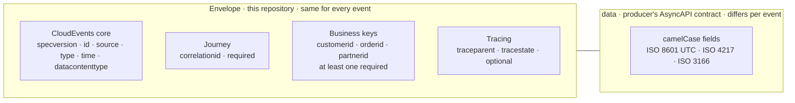

# contracts

The shared contracts of the
[AI Intelligence Domain demo](https://github.com/azure-intelligence-domain/ai-intelligence-domain)
integration platform. Owned by the **platform team**.

> Standardise the envelope, not the payload.

All contracts follow the **[adidas API guidelines](https://github.com/adidas/api-guidelines)**,
with the adaptations listed in
[ADR 0008](https://github.com/azure-intelligence-domain/ai-intelligence-domain/blob/main/docs/adr/0008-adidas-api-guidelines.md).

| Folder | What |
|---|---|
| [`schemas/envelope/`](schemas/envelope/) | The event envelope: CloudEvents 1.0 + `correlationid` + business keys. Versioned and immutable once released. |
| [`src/integration_envelope/`](src/integration_envelope/) | Python library to create and validate envelopes (`integration-envelope`). |
| [`asyncapi/landscape.asyncapi.yaml`](asyncapi/landscape.asyncapi.yaml) | Shared servers and security schemes every AsyncAPI contract refers to. |
| [`rulesets/`](rulesets/) | Spectral lint rules: the adidas ruleset (vendored, unmodified) plus this platform's rules. |
| [`templates/`](templates/) | Starting points for new contracts. They pass every lint rule. |

## The envelope

Every event on the platform is a CloudEvent in structured JSON mode
(`application/cloudevents+json`):

```json
{
  "specversion": "1.0",
  "id": "a1f3-77c2",
  "type": "com.acme.stock.reserved",
  "source": "/wms/stock-to-3pl/v2.4",
  "time": "2026-10-07T14:02:00Z",
  "datacontenttype": "application/json",
  "correlationid": "ord-4711",
  "customerid": "ACME",
  "orderid": "4711",
  "data": { "warehouseId": "BRU-01", "reservedQuantity": 12 }
}
```



| Rule | Enforced by |
|---|---|
| `correlationid` is required | schema `required` |
| At least one business key (`customerid`, `orderid`, `partnerid`) | schema `anyOf` |
| `time` is ISO 8601 in UTC (`Z`) | schema `pattern` (adidas common data types) |
| `type` is reverse-DNS, at least four segments | schema `pattern` |
| No `null` values, no unknown attributes from producers | schema types, `additionalProperties: false` |
| Consumers tolerate unknown attributes | `read()` (adidas robustness principle) |

Envelope attribute names are lowercase because CloudEvents requires it. The
`data` payload follows the adidas camelCase convention.

## Using the library

```python
from integration_envelope import BusinessKeys, new_event

event = new_event(
    type="com.acme.supply.stock.reserved",
    source="/system-api-wms/1.0.0",
    correlation_id="ord-4711",
    keys=BusinessKeys(customer_id="ACME", order_id="4711"),
    data={"warehouseId": "BRU-01", "reservedQuantity": 12},
)
```

Install a released version, pinned:

```toml
dependencies = [
  "integration-envelope @ git+https://github.com/azure-intelligence-domain/contracts@v1.0.0",
]
```

## Versioning

- Envelope and library follow semantic versioning.
- A released schema version is **immutable**: its SHA-256 is recorded in
  [`schemas/envelope/released.json`](schemas/envelope/released.json) and a test
  fails if the file changes. Changes go into a new version folder, following
  the adidas rules for extending (add only optional attributes).

## Development

```bash
uv sync && npm ci
uv run ruff check . && uv run pytest
npx spectral lint templates/*.yaml asyncapi/*.yaml --fail-severity=warn
```
